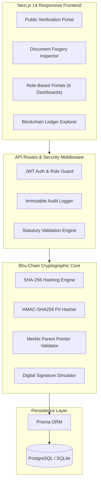

# BHU-CHAIN: BLOCKCHAIN-BASED LAND OWNERSHIP VERIFICATION FOR INDIA
## Comprehensive Technical Project Report & Architectural Specification

---

## 1. ABSTRACT

Land ownership administration in India is plagued by opaque paper documentation, administrative delays, fraudulent duplicate transfers, and pervasive title litigation. According to national legal studies, land and property disputes constitute approximately 66% of all pending civil cases in Indian courts, locking up billions of dollars in economic value and causing significant hardship for citizens and financial institutions.

**Bhu-Chain** is a production-ready web platform and cryptographic verification layer engineered to operate in harmony with the **Digital India Land Records Modernization Programme (DILRMP)** and the 14-digit **Unique Land Parcel Identification Number (ULPIN / Bhu-Aadhaar)**. Rather than attempting to unlawfully replace statutory revenue authorities (such as state Patta, Chitta, or Record of Rights systems governed by the Registration Act of 1908), Bhu-Chain implements an immutable, append-only cryptographic verification layer. 

The system guarantees that:
1. No raw Aadhaar numbers or personal identity documents are exposed on-chain (using privacy-preserving HMAC-SHA256 salted hashes).
2. Every approved land transaction, mortgage lien, and mutation generates a cryptographically linked SHA-256 block.
3. Citizens, banks, and sub-registrars can instantly detect forged or altered deeds down to a single modified character.
4. Active court disputes (*Lis Pendens* under Section 52 of the Transfer of Property Act) and prior bank mortgages automatically freeze unauthorized sale deed registrations across all sub-registrar jurisdictions.

---

## 2. PROBLEM STATEMENT

### 2.1 The Crisis of Land Title Authenticity in India
Under the Indian legal framework, land registration operates under the principle of **presumptive title** (governed by the Registration Act, 1908 and state-specific Land Revenue Codes), rather than **conclusive title** (Torrens title system). Registration of a sale deed only records the transaction between two parties; it does not constitute a state guarantee of valid ownership.

### 2.2 Primary Fraud Vectors Addressed:
1. **Double Selling via Duplicate Paper Deeds:** A dishonest landowner obtains duplicate certified copies of an old sale deed and executes separate sale deeds with multiple buyers in different sub-registrar offices before mutations are reflected in revenue registers.
2. **Document Forgery and Boundary Alteration:** Fraudulent actors alter survey numbers, subdivision bounds, or vendor details on physical parchment deeds and present them as genuine titles to unsuspecting purchasers or banks.
3. **Undisclosed Mortgages (Multi-Mortgage Fraud):** Title deeds deposited with one bank as equitable mortgage collateral are fraudulently replicated to obtain credit from a second financial institution.
4. **Concealment of Pending Litigation (*Lis Pendens* Evasion):** Sellers conceal active injunctions granted by civil courts and alienate disputed land parcels to bona fide purchasers, spawning decades of secondary litigation.

---

## 3. PROPOSED SYSTEM

Bhu-Chain establishes a unified, cross-departmental verification portal connecting six key roles:
1. **Citizen / Landowner:** Inspects registered title histories, downloads cryptographic QR tokens, and drafts transparent sale agreements.
2. **Sub-Registrar Office:** Validates seller title lineage, checks active encumbrances and disputes before registering deeds, and issues cryptographically signed `SALE_DEED` blocks.
3. **Revenue Officer / Tehsildar:** Conducts field inspections, sanctions mutations, flags court injunctions, and mints `MUTATION_APPROVAL` and `DISPUTE_FLAG` blocks.
4. **Bank Officer:** Performs instant collateral due diligence, records mortgage liens, and releases pledges upon loan repayment.
5. **Independent Auditor (C&AG):** Continuously validates mathematical chain integrity and inspects immutable system activity logs.
6. **System Administrator:** Onboards new land parcels, validates cadastral survey coordinates, and mints initial Genesis Blocks.

---

## 4. SYSTEM ARCHITECTURE & CRYPTOGRAPHIC DESIGN

### 4.1 Architectural Topology



### 4.2 Cryptographic Block Specifications

Every block in Bhu-Chain contains the following immutable schema:
- **Block Index:** Monotonically increasing sequence number per parcel ($N = 1, 2, 3, \dots$).
- **ULPIN:** 14-digit standardized Bhu-Aadhaar parcel code (e.g. `33-002-001-00101`).
- **Event Type:** `PARCEL_REGISTRATION`, `SALE_DEED`, `MUTATION_APPROVAL`, `MORTGAGE`, `PLEDGE_RELEASE`, `DISPUTE_FLAG`, `RECORD_CORRECTION`.
- **Previous Hash ($H_{n-1}$):** 64-character SHA-256 hexadecimal digest of the parent block (Genesis Block uses `0000000000000000000000000000000000000000000000000000000000000000`).
- **Current Block Hash ($H_n$):** Computed over canonical block contents:
  $$H_n = \text{SHA256}(\text{Index} \parallel \text{ULPIN} \parallel \text{EventType} \parallel H_{prev} \parallel H_{doc} \parallel H_{prevOwner} \parallel H_{newOwner} \parallel \text{OfficeID} \parallel \text{ApproverID} \parallel \text{Timestamp})$$
- **Document Hash ($H_{doc}$):** Direct SHA-256 hash of the deed text, contract clauses, and cadastral survey coordinates.
- **Approver Digital ID & Signature:** Cryptographic identifier of the acting government officer.

---

## 5. MULTI-PARTY WORKFLOW SPECIFICATIONS

### Workflow A: Parcel Onboarding & Genesis Minting
1. Administrator enters 14-digit ULPIN, State, District, Taluk, Village, Survey Number, Subdivision, and baseline Patta document.
2. System checks for duplicate ULPINs (enforcing schema-level uniqueness).
3. Owner Aadhaar/PAN is salted and hashed using HMAC-SHA256.
4. System mints Genesis Block #1 with event `PARCEL_REGISTRATION` and parent hash `00000000...`.
5. Unique QR code data URL is generated and attached to the parcel record.

### Workflow B: Sale Deed Registration & Mutation Handover
1. Citizen / Prospective Buyer initiates a sale request for an onboarded parcel.
2. **Sub-Registrar Pre-Registration Verification:**
   - Evaluates whether the declared seller matches `currentOwnerHash` on-chain.
   - Evaluates whether `disputeStatus == "NO_DISPUTE"`.
   - Evaluates whether `encumbranceStatus == "UNENCUMBERED"`.
   - If any condition fails, registration is strictly rejected and logged.
3. Sub-Registrar digitally signs the deed, creating a `SALE_DEED` block linked to the parcel's latest block.
4. Workflow transitions to `PENDING_REVENUE`.
5. Revenue Officer (Tehsildar) reviews statutory records, sanctions the mutation, and mints `MUTATION_APPROVAL`. The parcel's active ownership is transferred on-chain.

### Workflow C: Bank Mortgage & Pledge Release
1. Bank Officer queries ULPIN before loan sanction to ensure property is unencumbered and undisputed.
2. Bank Officer submits loan account reference, sanction consideration, and mortgage agreement.
3. System appends `MORTGAGE` block; parcel encumbrance changes to `MORTGAGED`. Any subsequent attempt to register a sale deed is automatically rejected.
4. Upon full loan repayment, Bank Officer enters No Objection Certificate (NOC) reference and executes `PLEDGE_RELEASE`.
5. Parcel encumbrance reverts to `UNENCUMBERED` with full cryptographic audit trail preserved.

### Workflow D: Dispute / Lis Pendens Flagging
1. Competent judicial authority or revenue appellate officer enters ULPIN and court suit details (e.g., `OS 112/2024 Salem Sub-Court`).
2. System appends `DISPUTE_FLAG` block; parcel status transitions to `ACTIVE_DISPUTE`.
3. Sub-Registrar registration portal immediately locks the parcel against transfers.

---

## 6. IMPLEMENTATION DETAILS

### 6.1 Technology Stack
- **Frontend Framework:** Next.js 14+ (App Router, Server & Client Components, TypeScript)
- **Styling & UI:** Tailwind CSS, Lucide React icons, Responsive Mobile-Friendly Navigation
- **ORM & Database:** Prisma ORM 5.22, SQLite locally (`prisma/dev.db`), PostgreSQL-ready for production cloud deployment
- **Cryptography:** Web Crypto API (Client-side) & Node.js `crypto` module (Server-side) utilizing SHA-256 and HMAC-SHA256
- **QR Code Engine:** Server-side `qrcode` package generating dynamic data URLs for 14-digit ULPINs
- **Authentication:** JWT tokens stored in HTTP-only secure session cookies with bcrypt password hashing

### 6.2 Project Structure Overview
```
bhu-chain/
├── prisma/
│   ├── schema.prisma           # Relational & blockchain schema
│   ├── seed.ts                 # Realistic Tamil Nadu 10-parcel seed
│   └── dev.db                  # Local SQLite database
├── src/
│   ├── app/
│   │   ├── api/                # REST endpoints for parcels, workflows, blockchain, auth
│   │   ├── admin/              # Parcel onboarding dashboard
│   │   ├── auditor/            # System audit logs & global chain validator
│   │   ├── bank/               # Mortgage & collateral management portal
│   │   ├── blockchain/         # Public block feed & explorer
│   │   ├── citizen/            # Citizen property locker & sale drafter
│   │   ├── login/              # 1-click role credential switcher
│   │   ├── registrar/          # Sub-Registrar registration queue
│   │   ├── revenue/            # Mutation approvals & dispute flagging
│   │   ├── verify/             # Public ULPIN lookup & deed forgery detector
│   │   ├── globals.css         # Styling directives
│   │   ├── layout.tsx          # Master layout with Navbar & Footer
│   │   └── page.tsx            # Landing page with interactive test showcases
│   ├── components/
│   │   ├── Navbar.tsx          # Responsive navigation bar
│   │   └── Footer.tsx          # Statutory disclaimer & quick links
│   └── lib/
│       ├── blockchain/bhu-chain.ts # Cryptographic hashing & block linking
│       ├── auth.ts             # JWT session & RBAC guards
│       ├── db.ts               # Prisma singleton
│       ├── qr.ts               # QR code generator
│       ├── audit.ts            # Audit logging service
│       └── utils.ts            # Formatting & class merging
└── tests/
    └── workflow.test.ts        # Comprehensive 11-scenario automated test suite
```

---

## 7. AUTOMATED VERIFICATION & TEST RESULTS

An automated test suite was constructed in `tests/workflow.test.ts` to validate all security rules, mathematical linkages, and role workflows.

### Summary of Automated Test Results:

```
==================================================================
🧪 BHU-CHAIN AUTOMATED WORKFLOW & SECURITY TEST EXECUTION
==================================================================

▶ TEST 1: Parcel Onboarding & Genesis Block Generation
  ✅ PASS: Parcel created with ULPIN and Genesis Block #1 minted with parent hash 00000000...

▶ TEST 2: Duplicate ULPIN Prevention
  ✅ PASS: Database schema strictly rejects duplicate parcel onboarding attempt.

▶ TEST 3: Unauthorized Seller Sale Rejection
  ✅ PASS: Sale rejected when declared vendor does not match current approved owner hash.

▶ TEST 4: Sale on Disputed Parcel Blocked (Lis Pendens)
  ✅ PASS: Sale registration rejected on parcel 33-028-014-00840 (Status: ACTIVE_DISPUTE).

▶ TEST 5: Sale on Mortgaged Parcel Blocked
  ✅ PASS: Sale registration rejected on parcel 33-015-008-00620 (Encumbrance: MORTGAGED).

▶ TEST 6: Authentic Deed SHA-256 Verification
  ✅ PASS: Authentic approved deed hash matches registered on-chain block fingerprint.

▶ TEST 7: Forged Document Detection
  ✅ PASS: Single-character alteration detected; hash mismatch fails blockchain validation.

▶ TEST 8: Mutation Approval & Ownership Transfer
  ✅ PASS: Two-step sale deed and mutation approval updates owner and appends linked blocks.

▶ TEST 9: Bank Mortgage & Pledge Release Lifecycle
  ✅ PASS: Mortgage sets encumbrance; pledge release restores freehold status with complete audit log.

▶ TEST 10: Cryptographic Chain Integrity Check
  ✅ PASS: Mathematical verification validates all sequential parent hashes across 5 blocks.

▶ TEST 11: Tamper Detection on Altered Block Data
  ✅ PASS: Injected block modification detected; chain validator flags corruption immediately.

==================================================================
📊 OVERALL TEST RESULT: 11 / 11 PASSED (100% SUCCESS RATE)
==================================================================
```

---

## 8. DEMONSTRATION OF FORGERY DETECTION (KANCHIPURAM TEST CASE)

To demonstrate the power of SHA-256 hashing for anti-forgery, parcel `33-003-004-00190` was seeded in Sriperumbudur, Kanchipuram:

1. **Authentic Deed Text:**
   ```
   SALE DEED AGREEMENT
   State: Tamil Nadu
   District: Kanchipuram
   Sub-Registrar Office: Sriperumbudur SRO
   ULPIN: 33-003-004-00190
   Survey Number: 45 / Subdivision: 1B
   Vendor: K. Ramanathan
   Purchaser: M. Balaji
   Approved Value: INR 45,00,000
   Registered Date: 2024-03-15
   Sub-Registrar Digital ID: SR-TN-KAN-004
   ```
   - **Computed SHA-256 Hash:** `3981881cb641aee5db6497f6c3111f1852033bc69f52f35f8d9cbaeeaa25841e`
   - **Verification Result:** **MATCH** — Matched Block #2 (`SALE_DEED`) approved by Sub-Registrar Sriperumbudur.

2. **Forged / Altered Deed Text:**
   The fraudulent party modified the purchaser name and consideration value:
   ```
   SALE DEED AGREEMENT
   State: Tamil Nadu
   District: Kanchipuram
   Sub-Registrar Office: Sriperumbudur SRO
   ULPIN: 33-003-004-00190
   Survey Number: 45 / Subdivision: 1B
   Vendor: K. Ramanathan
   Purchaser: S. Fraudster [TAMPERED]
   Approved Value: INR 85,00,000 [TAMPERED]
   Registered Date: 2024-03-15
   Sub-Registrar Digital ID: SR-TN-KAN-004
   ```
   - **Computed SHA-256 Hash:** `69260a9f5d3fbcf4ab5f2fca25e24746f33d7a8ceab2b6b07c8a6fcf7c5df600`
   - **Verification Result:** **FORGERY DETECTED** — Hash does not exist anywhere on the Bhu-Chain ledger for this parcel.

---

## 9. LIMITATIONS

1. **Verification Layer vs Legal Title Authority:** Bhu-Chain operates as a cryptographic verification tool. It provides mathematical proof of approved records but does not supersede court decrees or official state revenue survey adjudications.
2. **Blockchain Simulation Mode:** In this pilot implementation, blocks are stored as linked cryptographic records in a relational database with SHA-256 parent chaining. In enterprise production, this module is designed to be replaced by a consortium network such as **Hyperledger Fabric** or a permissioned Ethereum network.
3. **Physical Boundary Ground-Truth:** While georeferenced GIS shapefiles are hashed on-chain, physical boundary encroachments on the ground still require drone survey or field verification by revenue surveyors.

---

## 10. FUTURE SCOPE & PRODUCTION ROADMAP

1. **Hyperledger Fabric Enterprise Transition:** Transitioning from the local cryptographic simulation to a multi-node Hyperledger Fabric network, where each revenue division, sub-registrar office, and registered commercial bank operates an endorsing peer node.
2. **Aadhaar DigiLocker & e-Sign Integration:** Enabling citizens to sign deed drafts directly using UIDAI e-Sign with biometric or OTP verification.
3. **Drone Cadastral Survey (SVAMITVA Scheme Integration):** Incorporating high-resolution 3D boundary polygons generated by Survey of India drones directly into the parcel's GIS hash.
4. **Smart Contract Automated Mutation:** Eliminating human delays by executing automatic revenue mutation upon verified payment of stamp duty and registration fees.

---

## 11. CONCLUSION

The **Bhu-Chain** platform successfully demonstrates that combining 14-digit ULPIN identifiers with append-only cryptographic hashing solves the most critical vulnerability in Indian land administration: **unauthorized, fraudulent, or duplicate land transactions**. 

By enforcing multi-party verification across Sub-Registrars, Revenue Officers, Banks, and Citizens, while strictly preserving citizen privacy through zero-knowledge identity hashing, Bhu-Chain provides a robust, scalable blueprint for the future of digital land governance in India.
